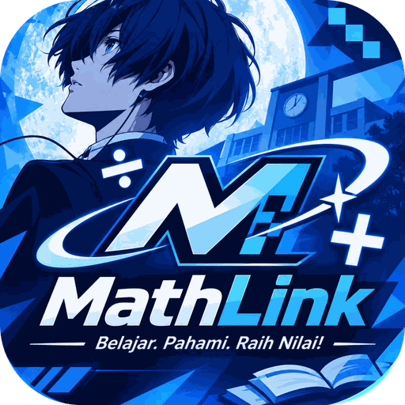

<div align="center">



# MathLink

### Belajar. Pahami. Raih Nilai!

Belajar **Perbandingan Senilai dan Berbalik Nilai** sambil bermain.
Materi bertahap, latihan dengan petunjuk, game melawan bos, dan sistem level bertema *Persona 3 Reload*.

<br>

[](https://fikriyustiawann.github.io/mathlink/)
[](https://github.com/FikriYustiawann/mathlink/actions)


<br>

[Tentang](#-tentang) ·
[Fitur](#-fitur) ·
[Level & Trophy](#-level-xp-dan-trophy) ·
[Cara Pakai](#-cara-pakai) ·
[Jalankan Sendiri](#-jalankan-sendiri) ·
[Deploy](#-deploy-ke-github-pages) ·
[Struktur](#-struktur-proyek)

</div>

---

## 🎯 Tentang

**MathLink** membantu siswa memahami dua jenis perbandingan yang sering tertukar:

| | Senilai | Berbalik nilai |
| --- | --- | --- |
| **Ciri** | Naik bersama, turun bersama | Yang satu naik, yang lain turun |
| **Tetap** | Hasil bagi `y ÷ x` | Hasil kali `x × y` |
| **Rumus** | `y = k × x` | `x × y = k` |
| **Grafik** | Garis lurus | Kurva menurun |

Kesulitan terbesarnya adalah **menentukan jenisnya dulu**, baru menghitung. Karena itu hampir semua fitur di sini
melatih langkah tersebut: membaca arah panah, mengisi tabel, mencari nilai satuan, lalu memeriksa hasilnya.

Isi dan alurnya disusun dari kebutuhan belajar siswa yang diwawancarai untuk penelitian pembelajaran,
bukan sekadar kumpulan soal.

## ✨ Fitur

Lobby punya **5 menu**:

### 📖 BELAJAR
Materi bertahap dalam **14 bagian**, dikelompokkan jadi lima kelompok.

| Kelompok | Isi |
| --- | --- |
| **Konsep** | Besaran dan rasio, senilai, berbalik nilai, kamus istilah |
| **Cara & Contoh** | Tiga cara menghitung (nilai satuan, rasio, kali silang), contoh soal, kisah sehari-hari, salah kaprah |
| **Ringkasan** | Rangkuman, cek cepat membedakan jenis, kartu rumus |
| **Video** | 6 video pilihan, dikelompokkan dari dasar sampai grafik dan soal |
| **Lainnya** | Buku dan bacaan, langkah berikutnya |

### 🎮 GAME
Lima game. Empat di antaranya punya **3 bos** (LV 1 sampai 3): jawaban benar melukai bos, jawaban salah membuat bos menyerang.

| Game | Cara main |
| --- | --- |
| **Shadow Battle** | Lawan Shadow di 3 lantai. Pilih jenis hubungan, lalu hitung. Ada ANALYZE untuk petunjuk |
| **Misi Relasi** | Baca arah panah: senilai atau berbalik nilai? |
| **Tebak Jenis** | 5 soal cerita acak. Tentukan jenisnya sebelum menghitung |
| **Isi Tabel** | Ketik angka yang hilang. Cari nilai satu satuan dulu |
| **Pasangan Rasio** | Kartu memori: cocokkan rasio senilai dan hasil kali yang sama |

### ✏️ LATIHAN
**10 misi soal cerita** (4 mudah, 4 menengah, 2 sulit), termasuk 3 soal **transfer** dengan konteks baru.

- Tiap soal dipecah **per tahap** dengan **petunjuk bertahap**
- Hasil dinilai **rank S / A / B / C** dengan gelar, lalu XP dan level naik
- Bagian **Belajar dari Kesalahan** mengumpulkan soal yang sering salah

### 🔬 LAB
Tempat mencoba tanpa tekanan.

- **Geser angka**, lihat tabel dan grafik ikut berubah (2 cerita untuk tiap jenis)
- **Hitung Bertahap**: satu langkah per ketukan
- **Tebak Dulu**: soal acak, tebak jenisnya sebelum melihat jawaban
- **Awas Salah Kaprah**: ciri dan rumus yang sering terbalik

### 📊 PROGRES dan 👤 PROFIL
PROGRES ada di menu lobby. PROFIL dibuka dengan mengetuk kartu status di pojok kiri atas lobby.

- Skor terbaik tiap mode, progres tiap menu, dan saran **langkah berikutnya**
- Level, XP, dan koleksi **22 trophy** (ketuk trophy untuk melihat cara membukanya)
- **Share Profile**: kartu profil ala kartu Steam dengan 3 trophy pilihanmu, bisa disimpan sebagai gambar

### 🎵 Suasana
- Tiap menu punya **lagu latar berbeda**, plus efek suara klik, benar, salah, dan pindah layar
- Tirai transisi antar layar, popup trophy, dan animasi hasil ala game
- Tampilan **bertema Persona 3 Reload**: menu miring, kartu status HP/SP, dan karakter pemandu

## 🏆 Level, XP, dan Trophy

**Level** memakai nama Arcana. Tiap **40 XP** naik satu level, dari Lv 1 sampai Lv 10:

`FOOL` → `MAGICIAN` → `PRIESTESS` → `EMPRESS` → `EMPEROR` → `HIEROPHANT` → `LOVERS` → `CHARIOT` → `JUSTICE` → `HERMIT`

**XP** didapat dari semua menu: membaca bagian materi dan menonton video, skor latihan, tebak jenis, game, mengalahkan bos, dan membuka trophy.
Di lobby, bar **HP** menunjukkan XP di level ini, dan bar **SP** menunjukkan jumlah misi latihan yang sudah dicoba.

**Rank misi** dihitung dari skor terbaik di tiap soal latihan:

| Rank | Skor | Gelar |
| :-: | :-: | --- |
| **S** | 100% | Penakluk Dark Hour |
| **A** | 75% atau lebih | Penjaga Hitungan |
| **B** | 50% atau lebih | Pemburu Rasio |
| **C** | di atas 0% | Murid Tartarus |

<details>
<summary><b>Lihat 22 trophy</b> (7 bronze · 9 silver · 5 gold · 1 platinum)</summary>

<br>

| Tier | Trophy | Cara membuka |
| --- | --- | --- |
| Bronze | Scholar of the Hour | Baca semua bagian di BELAJAR |
| Bronze | Visual Learner | Buka 3 video di BELAJAR |
| Bronze | Dark Hour Begins | Selesaikan satu soal di LATIHAN |
| Bronze | First Mission | Selesaikan satu ronde Misi Relasi |
| Bronze | Shadow Hunter | Kalahkan Shadow pertama di Shadow Battle |
| Bronze | Eye of the Arcana | Jawab semua kasus Tebak Jenis dengan benar |
| Bronze | Soul Unbound | Selesaikan satu soal tanpa petunjuk dengan skor minimal setengah |
| Silver | Table Tactician | Skor minimal 80% di Isi Tabel |
| Silver | Mind Palace | Skor minimal 80% di Pasangan Rasio |
| Silver | Rise from the Shadows | Ulangi satu soal dan kalahkan skor sebelumnya |
| Silver | Midnight Guardian | Selesaikan 6 soal (pengulangan dihitung) |
| Silver | Flawless Calculation | Skor sempurna pada satu soal |
| Silver | Efficiency King | Skor sempurna di "Memilih Pembuat Kaos" |
| Silver | Architect of Time | Skor sempurna di "Pekerja dan Waktu" |
| Silver | Precision Navigator | Skor sempurna di "Bensin Motor" |
| Silver | Fair Divider | Skor sempurna di "Patungan Pizza" |
| Gold | Relation Master | 50 poin di Misi Relasi |
| Gold | Tartarus Vanguard | Tuntaskan 3 lantai Shadow Battle |
| Gold | Conqueror of Tartarus | Selesaikan semua soal LATIHAN minimal sekali |
| Gold | Master of Ratios | Skor sempurna di semua soal senilai |
| Gold | Lord of Reciprocity | Skor sempurna di semua soal berbalik nilai |
| Platinum | Done and Dusted | Skor sempurna di semua soal |

</details>

## 🚀 Cara Pakai

1. Buka **https://fikriyustiawann.github.io/mathlink/** di browser HP atau laptop.
2. Ketik namamu (2 sampai 20 karakter) di kolom **USERNAME**, lalu tekan **MASUK**. Tanpa akun dan tanpa kata sandi.
3. Mulai dari **BELAJAR**, lanjut ke **LATIHAN**, lalu uji diri di **GAME**.

> Skor dan progres tersimpan di browser yang kamu pakai, per nama. Pindah browser atau perangkat berarti progres mulai dari awal.

## 💻 Jalankan Sendiri

Butuh **Node.js 22.13 atau lebih baru** (syarat Expo SDK 58).

```bash
npm install
npm run setup      # memasang versi library yang cocok dengan Expo SDK 58
npm run web        # buka http://localhost:8081
```

| Perintah | Fungsi |
| --- | --- |
| `npm run web` | Jalankan di browser |
| `npm run usb` | Uji di HP Android lewat kabel USB (Expo Go) |
| `npm run tunnel` | Uji di HP lewat internet, scan QR |
| `npm run build:web` | Hasilkan situs statis ke folder `dist/` |
| `npm run doctor` | Cek masalah konfigurasi |

Panduan lengkap uji di HP: [PANDUAN_UJI_HP.md](PANDUAN_UJI_HP.md).

**Kalau terasa berat di web:** latar animasi dimatikan secara bawaan di browser. Atur lewat `WEB_BG_ANIM` dan `PERF_MODE` di `src/config.js`.

## 🌐 Deploy ke GitHub Pages

Repo ini punya *workflow* otomatis di `.github/workflows/deploy.yml`. Setiap `push` ke cabang `main`, GitHub membuild lalu menayangkan situsnya secara gratis.

1. Di repo: **Settings → Pages → Source → GitHub Actions**
2. `push` ke `main`, lalu pantau di tab **Actions** (sekitar 3 sampai 6 menit)
3. Situs tayang di `https://<username>.github.io/<nama-repo>/`

Langkah lengkap dari nol dan solusi masalah umum: **[PANDUAN_GITHUB.md](PANDUAN_GITHUB.md)**.

## 🧱 Struktur Proyek

<details>
<summary><b>Lihat struktur folder</b></summary>

```
App.js                        navigasi antar layar, musik, tombol Back Android
index.js                      titik masuk
app.json                      konfigurasi Expo
.github/workflows/deploy.yml  build dan tayang otomatis ke GitHub Pages
docs/                         logo dan gambar untuk README
src/
  config.js                   teks, menu, karakter, musik, mode performa
  data.js                     soal latihan dan isi kasus
  materiData.js               isi menu BELAJAR (14 bagian, video)
  gamedata.js                 pembuat soal acak untuk game
  trophies.js                 trophy, XP, level, rank
  theme.js                    palet warna
  screens/                    Lobby, Materi, Latihan, Game, Lab, Progres, Profil, Login
  screens/games/              Battle, IsiTabel, PasanganRasio
  components/                 latar bergerak, karakter, menu lobby, kartu status, bos, efek
  utils/storage.js            penyimpanan (localStorage di web, AsyncStorage di HP)
assets/                       ikon, font Inter, musik, efek suara, emoji 2D
tools/                        skrip pembuat musik dan emoji
```

</details>

Mengubah isi tanpa menyentuh komponen:
teks, menu, karakter, dan performa di `src/config.js` · soal dan kasus di `src/data.js` · materi di `src/materiData.js` · warna di `src/theme.js`.
Catatan pengembangan lengkap ada di [PROJECT_NOTES.md](PROJECT_NOTES.md).

## 🛠️ Teknologi

[Expo](https://expo.dev) SDK 58 · [React Native](https://reactnative.dev) · React Native Web · Animated API · expo-audio · expo-font ([Inter](https://rsms.me/inter/)) · react-native-view-shot · GitHub Actions + GitHub Pages

## ⚖️ Aset dan Hak Cipta

- **Karakter dan tema.** Makoto Yuki dan *Persona 3 Reload* adalah milik **ATLUS / SEGA**. Gambar karakter **tidak disertakan** di repo (lihat `.gitignore`).
- **Musik.** Lagu lobby (`assets/music/bgm.mp3`) adalah lagu berhak cipta pilihan pembuat. Lagu untuk menu lain adalah komposisi orisinal hasil sintesis (`tools/make_music.py`). Untuk rilis publik atau toko aplikasi, ganti dengan musik bebas royalti.
- **Font.** [Inter](https://rsms.me/inter/), lisensi SIL OFL (`assets/fonts/LICENSE-Inter.txt`).
- Proyek ini dibuat untuk keperluan belajar dan **bukan produk resmi** ATLUS / SEGA.

## 👤 Pembuat

**Fikri Yustiawan** · Pendidikan Matematika, FKIP Untirta
GitHub: [@FikriYustiawann](https://github.com/FikriYustiawann)

<div align="center">

<sub>Belajar. Pahami. Raih Nilai!</sub>

</div>
